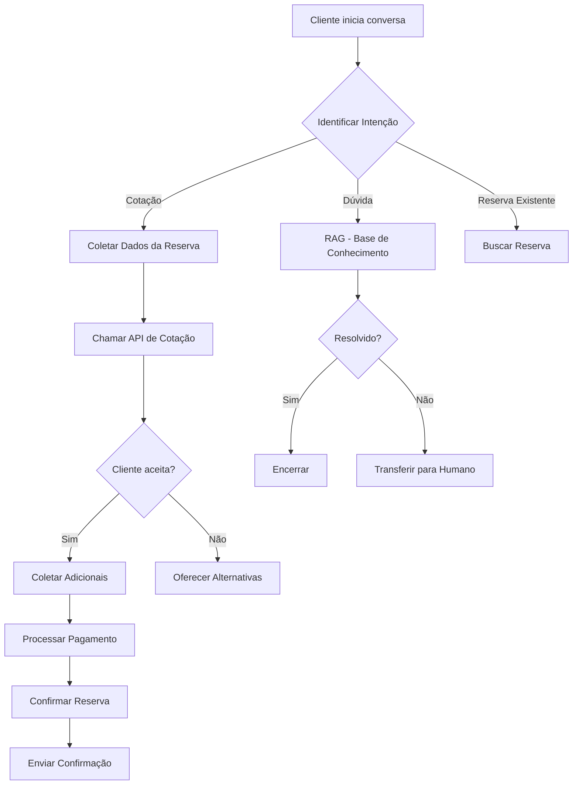

# Desafio Técnico - Senior AI Engineer

**Empresa:** Localiza&Co
**Posição:** Senior AI Engineer
**Formato:** Design de Arquitetura (Excalidraw)

---

## 🎯 O Desafio

> Você é o(a) Senior AI Engineer responsável pelo desenho da arquitetura e implementação de um **chatbot com IA Generativa** que realize todas as etapas de reserva da Localiza — tirar dúvidas, gerar cotações, incluir adicionais e efetivar reservas.

---

## 📊 Critérios de Avaliação

| # | Critério | Descrição |
|---|----------|-----------|
| 1 | **Levantamento de Requisitos** | Capacidade de identificar e documentar requisitos funcionais e não-funcionais |
| 2 | **Arquitetura da Plataforma** | Design dos componentes, integrações e fluxo de dados |
| 3 | **Orquestração Multi-Modelo/Provider** | Estratégia para gerenciar múltiplos LLMs e providers |
| 4 | **Escalabilidade** | Capacidade do sistema de crescer com a demanda |
| 5 | **Custos** | Otimização e previsibilidade de custos de infraestrutura e APIs |

---

## 🛠️ Stack de Tecnologias Sugeridas

### Containers & Orquestração
- **Docker** - Containerização
- **Kubernetes** - Orquestração de containers

### Backend & APIs
- **Node.js** - Runtime JavaScript
- **REST API** - Comunicação síncrona
- **Kafka** - Streaming de eventos
- **Message Queue** - Comunicação assíncrona

### Dados & Cache
- **Database** - Armazenamento persistente (PostgreSQL, MongoDB)
- **Redis** - Cache e sessões

### IA & Machine Learning
- **LLM** - Large Language Models (GPT, Claude, Llama)
- **LRM** - Language Retrieval Models (RAG)

### Segurança & Frontend
- **Auth & IAM** - Autenticação e autorização
- **React** - Interface do usuário (se aplicável)

---

## 💡 Dicas dos Avaliadores

### Antes de Começar
- ✅ Garanta que você compreenda **totalmente o fluxo de reservas**
- ✅ Os dados podem vir de **múltiplas fontes** - identifique-as

### Durante o Design
- ✅ O objetivo é a **arquitetura** - descreva os blocos e como se conectam
- ✅ **Foco!** Não se perca em detalhes de implementação
- ✅ **Evite suposições** - levantar requisitos é uma habilidade essencial

### Decisões
- ✅ **Tome decisões claras** - evite respostas abertas
- ✅ Demonstre clareza nas escolhas arquiteturais e de stack
- ✅ Justifique suas escolhas com trade-offs

### Documentação
- ✅ **Registre tudo** que descobrir:
  - Requisitos levantados
  - Decisões tomadas
  - Trade-offs considerados
  - Tudo que considerar relevante

---

## 📋 Requisitos a Levantar

### Funcionais
- [ ] Quais canais o chatbot deve atender? (WhatsApp, Web, App, Voz)
- [ ] Quais tipos de reserva? (Diária, Mensal, Corporativo)
- [ ] Quais adicionais podem ser incluídos?
- [ ] Como funciona o fluxo de cotação atual?
- [ ] Quais integrações com sistemas legados são necessárias?
- [ ] O chatbot deve processar pagamentos?
- [ ] Qual o escopo de "tirar dúvidas"? (FAQ, políticas, veículos)

### Não-Funcionais
- [ ] Qual o volume esperado de atendimentos? (pico e média)
- [ ] Qual o SLA de resposta esperado?
- [ ] Requisitos de disponibilidade (99.9%?)
- [ ] Requisitos de compliance (LGPD, PCI-DSS)
- [ ] Orçamento disponível para infraestrutura e APIs de IA
- [ ] Latência máxima aceitável por interação
- [ ] Requisitos de fallback para atendimento humano

---

## 🏗️ Proposta de Arquitetura (Exemplo)

```
┌─────────────────────────────────────────────────────────────────┐
│                        CANAIS DE ENTRADA                        │
├─────────────┬─────────────┬─────────────┬─────────────┬────────┤
│  WhatsApp   │    Web      │     App     │   Portal    │  Voz   │
│  (Twilio)   │  (React)    │  (Mobile)   │  (Cliente)  │ (IVR)  │
└──────┬──────┴──────┬──────┴──────┬──────┴──────┬──────┴───┬────┘
       │             │             │             │          │
       └─────────────┴──────┬──────┴─────────────┴──────────┘
                            │
                            ▼
┌─────────────────────────────────────────────────────────────────┐
│                      API GATEWAY / LOAD BALANCER                │
│                         (Kong / AWS ALB)                        │
└────────────────────────────────┬────────────────────────────────┘
                                 │
                                 ▼
┌─────────────────────────────────────────────────────────────────┐
│                     ORQUESTRADOR DE CONVERSAS                   │
│                        (Conversation Engine)                    │
│  ┌─────────────┐  ┌─────────────┐  ┌─────────────────────────┐  │
│  │   Session   │  │   Context   │  │   Intent Recognition    │  │
│  │   Manager   │  │   Manager   │  │   & Slot Filling        │  │
│  └─────────────┘  └─────────────┘  └─────────────────────────┘  │
└────────────────────────────────┬────────────────────────────────┘
                                 │
            ┌────────────────────┼────────────────────┐
            │                    │                    │
            ▼                    ▼                    ▼
┌───────────────────┐ ┌───────────────────┐ ┌───────────────────┐
│   LLM ROUTER      │ │   RAG ENGINE      │ │   FUNCTION        │
│   (Multi-Model)   │ │   (Knowledge)     │ │   CALLING         │
│                   │ │                   │ │                   │
│ ┌───────────────┐ │ │ ┌───────────────┐ │ │ ┌───────────────┐ │
│ │ OpenAI GPT-4  │ │ │ │ Vector DB     │ │ │ │ Reservas API  │ │
│ │ Claude        │ │ │ │ (Pinecone)    │ │ │ │ Cotações API  │ │
│ │ Llama (local) │ │ │ │ Embeddings    │ │ │ │ Pagamentos    │ │
│ └───────────────┘ │ │ └───────────────┘ │ │ │ Adicionais    │ │
└───────────────────┘ └───────────────────┘ │ └───────────────┘ │
                                           └───────────────────┘
                                 │
                                 ▼
┌─────────────────────────────────────────────────────────────────┐
│                      CAMADA DE INTEGRAÇÃO                       │
│  ┌─────────────┐  ┌─────────────┐  ┌─────────────────────────┐  │
│  │   Kafka     │  │   Redis     │  │   Message Queue         │  │
│  │   Events    │  │   Cache     │  │   (RabbitMQ/SQS)        │  │
│  └─────────────┘  └─────────────┘  └─────────────────────────┘  │
└────────────────────────────────┬────────────────────────────────┘
                                 │
                                 ▼
┌─────────────────────────────────────────────────────────────────┐
│                      SISTEMAS LEGADOS LOCALIZA                  │
│  ┌─────────────┐  ┌─────────────┐  ┌─────────────────────────┐  │
│  │   Sistema   │  │   Sistema   │  │   Sistema de            │  │
│  │   Reservas  │  │   Frotas    │  │   Pagamentos            │  │
│  └─────────────┘  └─────────────┘  └─────────────────────────┘  │
└─────────────────────────────────────────────────────────────────┘
```

---

## 🔄 Fluxo de Atendimento



---

## 💰 Considerações de Custo

### APIs de LLM (estimativa por 1M tokens)
| Provider | Input | Output |
|----------|-------|--------|
| OpenAI GPT-4 | $30 | $60 |
| OpenAI GPT-3.5 | $0.50 | $1.50 |
| Claude 3 Opus | $15 | $75 |
| Claude 3 Sonnet | $3 | $15 |
| Llama (self-hosted) | Infra | Infra |

### Estratégias de Otimização
1. **Roteamento inteligente** - Usar modelos mais baratos para tarefas simples
2. **Caching** - Cachear respostas frequentes (FAQ)
3. **Fallback local** - Llama para picos de demanda
4. **Streaming** - Reduzir latência percebida
5. **Compressão de contexto** - Limitar histórico enviado

---

## 📈 Escalabilidade

### Horizontal
- Kubernetes com HPA (Horizontal Pod Autoscaler)
- Múltiplas réplicas do orquestrador
- Load balancing entre providers de LLM

### Vertical
- GPU para modelos locais (Llama)
- Instâncias otimizadas para inferência

### Resiliência
- Circuit breaker para APIs externas
- Retry com exponential backoff
- Fallback para atendimento humano
- Multi-region deployment

---

## 🔐 Segurança & Compliance

- **LGPD** - Anonimização de dados pessoais nos logs
- **PCI-DSS** - Não armazenar dados de cartão
- **Auth** - OAuth 2.0 / JWT para APIs
- **Encryption** - TLS 1.3 em trânsito, AES-256 em repouso
- **Rate Limiting** - Proteção contra abuso
- **Audit Logs** - Rastreabilidade de todas as ações

---

## 📚 Referências

- [Localiza - Chatbot Liza atual](https://tiinside.com.br/10/09/2025/localizaco-aposta-em-inteligencia-artificial-para-escalar-atendimento-digital-com-sua-assistente-virtual-liza/)
- [OpenAI Function Calling](https://platform.openai.com/docs/guides/function-calling)
- [LangChain - Orquestração de LLMs](https://langchain.com/)
- [RAG Pattern](https://www.pinecone.io/learn/retrieval-augmented-generation/)

---

*Documento criado para apoio ao desafio técnico de Senior AI Engineer - Localiza*
