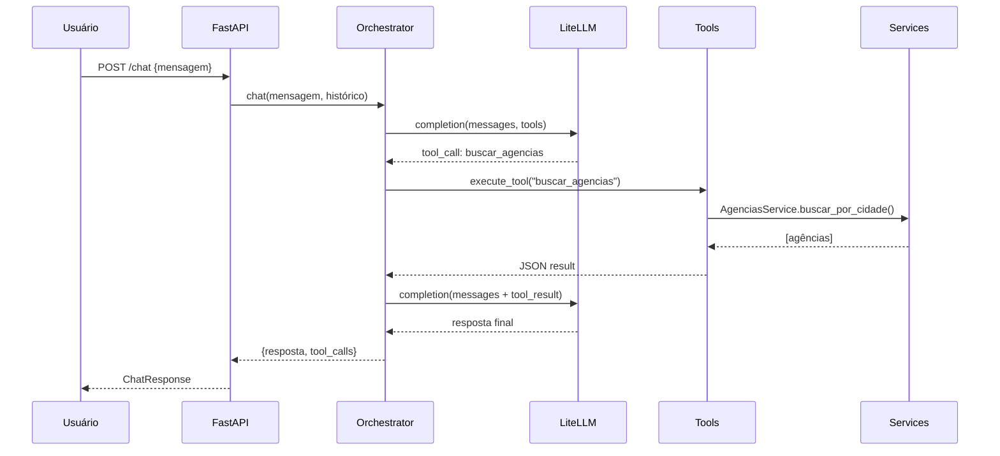

# 🚗 Chatbot Localiza - Protótipo

Protótipo funcional do chatbot de cotação e reserva de veículos da Localiza.

## 🎯 Objetivo

Demonstrar a arquitetura proposta para o desafio de Senior AI Engineer, com:
- **LiteLLM** para orquestração multi-modelo
- **Function Calling** para integração com APIs
- **FastAPI** como backend de alta performance

## 🏗️ Arquitetura

```
┌─────────────────────────────────────────────────────────────┐
│                       FastAPI                               │
│                      (main.py)                              │
└─────────────────────────────┬───────────────────────────────┘
                              │
                              ▼
┌─────────────────────────────────────────────────────────────┐
│                   ChatOrchestrator                          │
│                   (llm/orchestrator.py)                     │
│                                                             │
│  ┌─────────────┐    ┌─────────────┐    ┌─────────────┐     │
│  │   LiteLLM   │ ←→ │    Tools    │ ←→ │  Services   │     │
│  │  GPT-4/etc  │    │  (tools.py) │    │  (mock APIs)│     │
│  └─────────────┘    └─────────────┘    └─────────────┘     │
└─────────────────────────────────────────────────────────────┘
                              │
                              ▼
┌─────────────────────────────────────────────────────────────┐
│                       Services                              │
├─────────────────┬─────────────────┬─────────────────────────┤
│   AgenciasService   │   CarrosService   │   CotacaoService   │
│   (10 agências)     │   (15 veículos)   │   (geração)        │
└─────────────────┴─────────────────┴─────────────────────────┘
```

## 🚀 Quick Start

### 1. Instalar dependências

```bash
cd prototype
pip install -r requirements.txt
```

### 2. Configurar API Key (opcional)

```bash
cp .env.example .env
# Editar .env e adicionar OPENAI_API_KEY
```

> ⚠️ Sem API Key, o chatbot funciona em **modo mock** com respostas pré-definidas.

### 3. Rodar o servidor

```bash
python main.py
```

### 4. Testar

Acesse: http://localhost:8000/docs

Ou via curl:

```bash
# Iniciar conversa
curl -X POST http://localhost:8000/chat \
  -H "Content-Type: application/json" \
  -d '{"mensagem": "Quero alugar um carro em São Paulo"}'

# Listar agências (demo)
curl http://localhost:8000/demo/agencias?cidade=SP

# Listar grupos de veículos (demo)
curl http://localhost:8000/demo/grupos
```

## 📁 Estrutura

```
prototype/
├── main.py                 # FastAPI application
├── requirements.txt        # Dependências Python
├── .env.example           # Exemplo de configuração
├── README.md              # Este arquivo
│
├── llm/
│   ├── __init__.py
│   ├── orchestrator.py    # Orquestrador LiteLLM + Function Calling
│   └── tools.py           # Definição das tools (buscar_agencias, etc)
│
├── services/
│   ├── __init__.py
│   ├── agencias.py        # Mock API de agências
│   ├── carros.py          # Mock API de veículos e adicionais
│   └── cotacao.py         # Mock API de cotação
│
└── models/
    ├── __init__.py
    └── schemas.py         # Pydantic models
```

## 🛠️ Tools Disponíveis (Function Calling)

| Tool | Descrição | Parâmetros |
|------|-----------|------------|
| `buscar_agencias` | Busca agências por cidade | `cidade`, `apenas_aeroportos` |
| `listar_grupos_veiculos` | Lista grupos com preços | - |
| `gerar_cotacao` | Cria cotação | `agencia_retirada_id`, `data_retirada`, `data_devolucao`, `grupo_veiculo` |
| `listar_adicionais` | Lista extras disponíveis | - |
| `adicionar_item_cotacao` | Adiciona extra à cotação | `cotacao_id`, `adicional` |

## 📊 Dados Mock

### Agências (10)
- Belo Horizonte: Confins (aeroporto), Savassi, Pampulha
- São Paulo: Guarulhos, Congonhas, Paulista, Faria Lima
- Rio de Janeiro: Galeão, Santos Dumont, Copacabana

### Grupos de Veículos (7)
| Grupo | Nome | Exemplo | Diária |
|-------|------|---------|--------|
| A | Econômico | Mobi | R$ 89,90 |
| B | Compacto | HB20 | R$ 119,90 |
| C | Intermediário | Virtus | R$ 149,90 |
| D | Sedan | Corolla | R$ 199,90 |
| E | SUV | Creta | R$ 249,90 |
| F | Pickup | Toro | R$ 229,90 |
| G | Luxo | BMW 320i | R$ 449,90 |

### Adicionais (6)
- Cadeirinha Bebê: R$ 25/dia
- Cadeirinha Infantil: R$ 25/dia
- GPS: R$ 20/dia
- Condutor Adicional: R$ 30/dia
- Proteção Básica: R$ 40/dia
- Proteção Premium: R$ 80/dia

## 🔄 Fluxo de Conversa



## 🧪 Testando o Fluxo Completo

1. **Buscar agências:**
   ```
   Usuário: "Quero alugar um carro em São Paulo"
   Bot: [executa buscar_agencias] "Encontrei 4 agências em SP..."
   ```

2. **Ver preços:**
   ```
   Usuário: "Quais os tipos de carro disponíveis?"
   Bot: [executa listar_grupos_veiculos] "Temos 7 grupos..."
   ```

3. **Gerar cotação:**
   ```
   Usuário: "Quero um SUV do dia 15/02 até 20/02 no aeroporto de Guarulhos"
   Bot: [executa gerar_cotacao] "📋 COTAÇÃO #ABC123..."
   ```

4. **Adicionar extras:**
   ```
   Usuário: "Inclui uma cadeirinha de bebê"
   Bot: [executa adicionar_item_cotacao] "Adicionei! Novo total: R$ X"
   ```

## 🔑 Variáveis de Ambiente

| Variável | Descrição | Default |
|----------|-----------|---------|
| `OPENAI_API_KEY` | Chave da API OpenAI | - |
| `LLM_MODEL` | Modelo principal | `gpt-4o-mini` |
| `LLM_FALLBACK` | Modelo de fallback | `gpt-3.5-turbo` |
| `HOST` | Host do servidor | `0.0.0.0` |
| `PORT` | Porta do servidor | `8000` |

## 📈 Próximos Passos (Produção)

- [ ] Integrar APIs reais da Localiza
- [ ] Adicionar Redis para sessões e cache
- [ ] Implementar RAG com LlamaIndex + Qdrant
- [ ] Adicionar autenticação (JWT)
- [ ] Deploy em Kubernetes com HPA
- [ ] Monitoramento com Prometheus/Grafana

---

*Protótipo desenvolvido para o desafio técnico de Senior AI Engineer - Localiza*
